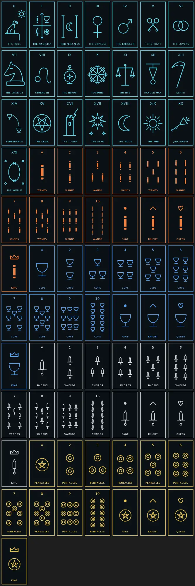

# Tarot Machine

A pocket tarot-draw gadget built on an M5StickS3. Press a button and it draws a random card from a standard tarot deck, shows the card and its meaning, and eventually speaks. "Tarot Machine" is a working title.

**Status: in progress.** The device draws a random card from my own 78 meanings, shows the card art tinted by suit, and flips to the meaning. Version 4 adds a battery indicator and a home button. Sound and voice are next.

---

## Introduction

This is my first hardware build. I learn by doing, and I wanted a project interesting enough to actually finish.

The inspiration is Finbarre Snarey's TAROTRON 2000. That build and its design are his. This page covers my own version on an M5StickS3.

The device is an M5Stack StickS3: an ESP32-S3 board with a 1.14" screen, a speaker, buttons and a motion sensor, all in one small case. It needs no soldering and no extra parts.

What's done so far:

- Chose the hardware and ordered it.
- Set up Arduino IDE 2 with the M5Stack board package and the M5Unified and M5GFX libraries.
- Wrote all 78 card meanings myself, upright and reversed, in a pipe-delimited `cards.txt`.
- Set up the sketchbook so each version of the build gets its own sketch folder.
- Wrote `convert.py`, a Python script that turns `cards.txt` into `cards.h`, a C++ file the sketch can use. `cards.txt` is the only file I edit. `cards.h` is generated and never edited by hand.
- Researched card art: public-domain decks, pixel-art packs and drawing my own. Went with a 1-bit card set at the screen's size, 135×240.
- Got my first sketch running on the stick: "hello Spec" on the screen. Session 1 complete.
- Drew random cards on the device: a press picks one of the 78 cards with `esp_random()`, with a 50/50 reversal.
- Added card art: 78 one-bit images converted to C arrays in image2cpp, tinted by suit at draw time.
- Added a flip animation and tap/hold controls on one button: tap flips between the art and the meaning, hold draws a new card.
- Meanings auto-size to fit the screen, and the screen sleeps after 60 seconds without a press.
- Fixed a bug where Wands cards showed the wrong meaning, and hardened `convert.py`: it escapes quotes, checks the card order before writing, and writes `cards.h` straight into the newest sketch folder.
- Version 4: a battery indicator and the sketch version on the opening screen, and the side button goes home from anywhere.

Controls: front tap flips between the art and the meaning, front hold draws a new card, side button goes back to the opening screen.

The decisions behind each of these are in [DEVLOG.md](./DEVLOG.md).

### The card art

Each card is a border coded around the display, some text, and a common symbol: five cups for the 5 of Cups, the astrological sign for Leo on Strength. Symbols like these are freely available UI icons. I put the set together with Claude. I think AI-generated art is bad, and I'm honestly unsure whether placing an icon like this counts, so the full story is in [DEVLOG.md](./DEVLOG.md) (Entry 009).

---

## Constraints

**Not hardware-random.**  
`esp_random()` is only true hardware randomness while the radio is on. Without it, the numbers come from a formula. Fair for a tarot draw, but not hardware-random.

**Screen sleep only.**  
M5Stack's docs only show deep sleep with timer wake-up, not button wake-up. True deep sleep is parked until I can test it properly.

**Some manual steps left.**  
After running `convert.py` I still reopen the sketch by hand before uploading, and `card_art.h` isn't part of the pipeline yet. Folding it in is on the ideas list.

**First hardware build.**  
I'm learning the board, the libraries and the Arduino workflow as I go. The build is split into short sessions so each step is small enough to finish.

**Parts kept to the stick and a cable.**  
No soldering, no extra sensors, no add-on kits. Everything planned has to work with what the StickS3 already has.

---

## Roadmap

1. **Get the device talking to the computer** — "hello" on screen. Done 2026-10-14.
2. **First draw** — button press gives a random card name, with reversals. Done 2026-10-14.
3. **Meanings on screen.** Done 2026-10-14. Wands order bug fixed 2026-10-15.
4. **Sound effects.**
5. **Card images.** Done 2026-10-14.
6. **Voice, shake-to-draw, modes, case.**

Feature ideas that come up along the way go into an ideas file, not into the current session.

### Ideas for later

**Feels like a real deck**
- **No repeats until the deck runs out:** shuffle the 78 once and deal through them, the way a physical deck works. Right now the same card can come up twice in a row.
- **Three-card spread:** past / present / future. Tap to step through, then see all three names together.
- **Card back during the flip:** show a card-back design for a moment mid-flip instead of an empty outline.
- **Shake to draw:** use the motion sensor for a shuffle gesture.

**Comfort and battery**
- **Sound:** a shuffle noise while drawing, a chime on the flip, and a mute option.
- **Live battery refresh** on the opening screen, plus a low-battery warning on any screen.
- **Full power-off** after a long idle, using the power chip's shutdown (M5Stack documents this). Needs testing to confirm the power button wakes it cleanly.
- **Brightness setting:** lower brightness saves battery.

**Settings that stick**
- **Remember settings across restarts** (mute, brightness, reversals on or off) using the ESP32's built-in storage.
- **Reversals toggle:** some readers don't use them.

**Tooling**
- Fold `card_art.h` into the pipeline so a new version folder gets everything from one command.
- A short README in the project folder documenting the workflow and controls.

**Hardware**
- A case, designed once the controls are final.

---

## Stack

- **Hardware:** M5Stack StickS3 (SKU K150), USB-C data cable
- **Development:** Arduino IDE 2, M5Stack board package, M5Unified and M5GFX libraries
- **Python:** `convert.py` generates `cards.h` from `cards.txt`
- **Card art:** 78 one-bit images at 135×240, common symbols put together with Claude, converted to C arrays with image2cpp and drawn with `drawBitmap()`
- **Randomness:** `esp_random()`
- **Battery:** `M5.Power.getBatteryLevel()` and `isCharging()`
